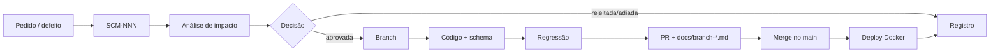

---
tags:
  - manutencao
  - sebras
---

# Plano de manutenção — Sebras

Cabeçalho: [[Padrao-documental]]. Processo de mudança: [[Solicitacao-de-mudanca]] · [[Registro-de-mudancas]].  
Testes de regressão: [[Plano-de-testes-sebras]].

## Controle de revisões

| Versão | Descrição | Data | Autor | Revisor |
|---|---|---|---|---|
| 0.1 | Plano de manutenção inicial | 2026-10-15 | Equipe Sebras | Pendente |

## 1. Introdução

### 1.1 Propósito
Definir como o Sebras é corrigido, adaptado, evoluído e preservado depois de entregue, sem quebrar as [[Regras-de-negocio]] nem a integridade do voto ([[RNF05]]).

### 1.2 Escopo
Aplicação do `main`: WildFly + Oracle via Docker, [[RF01]] … [[RF11]], regras [[RN01]] … [[RN10]], schema `resource/schema.sql` ([[schema-sebras]]).

### 1.3 Fora do escopo
- Visual da branch `frontend` ([[RNF08]]) até virar RF
- Autenticação ([[RNF07]])
- Integração com TSE / urna oficial

### 1.4 Referências
[[ERS]] · [[Catalogo-de-requisitos]] · [[Matriz-rastreabilidade-sebras]] · [[Escopo-atual]]

## 2. Tipos de manutenção

Os mesmos quatro tipos do campo *Tipo* da [[Solicitacao-de-mudanca]].

| Tipo | O que é | Exemplo real no Sebras |
|---|---|---|
| Corretiva | Corrige defeito | `eleitor.cpf` aceita qualquer texto (sem validação de dígito); [[SCM-001]] já foi corretiva |
| Adaptativa | Ajusta a mudança de ambiente | Nova versão do Oracle Free, WildFly, Java ([[RNF02]], [[RNF03]], [[RNF04]]) |
| Evolutiva | Novo requisito | Apuração por estado/região/Brasil (hoje só por zona, [[RN10]]); urnas e status de apuração |
| Preventiva | Evita defeito futuro | Unique em `partido.numero`/`sigla` e em `candidatura (eleicao_id, cargo_id, numero)`; remover `eleitor.votou`, que duplica `comparecimento` |

## 3. Processo de manutenção

1. **Registrar**: abrir `SCM-NNN` a partir de `_templates/solicitacao-mudanca.md` e listar em [[Registro-de-mudancas]].
2. **Analisar impacto**: usar a [[Matriz-rastreabilidade-sebras]] para achar RC → RF → CU → RN → CT afetados.
3. **Decidir**: aprovada / rejeitada / adiada, com aprovador e data.
4. **Implementar**: uma branch por SCM, com nome curto (ex.: `scm-002-cpf`).
5. **Testar**: rodar os CT afetados e mais a regressão mínima (seção 6).
6. **Documentar**: PR com `docs/branch-<nome>.md` e linha na tabela de `docs/README.md` (regra do projeto).
7. **Implantar**: merge no `main`, `mvn clean package`, `docker compose up --build`.
8. **Fechar**: SCM com `status: aprovada` e o resultado da regressão anotado.

Toda mudança que mexe em regra de negócio, schema ou RF já documentado **precisa** de SCM. Ajuste de texto ou de layout sem regra não precisa.

## 4. Classificação e prazos

Prioridade no padrão de [[Classificacao-priorizacao-sebras]] (5 = primeiro).

| Severidade | Quando | Prioridade | Prazo alvo |
|---|---|---|---|
| Crítica | Voto errado, voto perdido, voto duplicado, resultado errado ([[RF09]], [[RF10]], [[RN06]], [[RN07]]) | 5 | Mesmo dia |
| Alta | Cadastro que impede votar (eleitor, eleição, candidatura) | 4 | 2 dias |
| Média | Cadastro de apoio (município, zona, seção, cargo), abstenção | 3 | 1 semana |
| Baixa | Texto, layout, melhoria sem regra | 1–2 | Próxima versão |

## 5. Calendário eleitoral

Sistema eleitoral tem janela. A manutenção obedece ao turno.

| Fase | Período | O que pode |
|---|---|---|
| Preparação | Até 30 dias antes do 1º turno | Toda manutenção, inclusive evolutiva e schema |
| Congelamento | 30 dias antes → fim da apuração | Só corretiva **crítica**, com SCM aprovada e regressão completa |
| Votação / apuração | Dia do turno | Plantão; nenhum deploy salvo falha crítica |
| Entre turnos | Após 1º turno → 2º turno | Só corretiva crítica/alta que não toque [[RN02]], [[RN05]] |
| Pós-eleição | Após apuração final | Evolutiva, preventiva, adaptativa; lições aprendidas |

## 6. Regressão mínima por mudança

Casos de [[Plano-de-testes-sebras]] que rodam **sempre**, qualquer que seja a mudança:

| CT | Por quê |
|---|---|
| CT-RF09-01 | Voto válido grava comparecimento + voto |
| CT-RF09-02 | Segundo voto recusado ([[RN06]]) |
| CT-RF09-03 | Eleição inativa recusada ([[RN01]]) |
| CT-RF10-01 | Resultado reflete o voto |
| CT-RF11-01 | Abstenção reflete quem não votou |

E mais todos os CT do RF/RN apontado no campo *Afeta* da SCM.

## 7. Gestão de configuração

| Item | Regra |
|---|---|
| Código | Git, `main` sempre implantável; uma branch por SCM; merge só via PR |
| Versão | `pom.xml` `major.minor.patch`: corretiva → patch, evolutiva → minor, quebra de schema → major |
| Schema | `resource/schema.sql` é a fonte; toda mudança vira SCM e é espelhada em [[schema-sebras]] |
| Ambiente | `docker-compose.yml` + `docker/` versionados; nada configurado à mão no container |
| Documentação | `docs/branch-*.md` por PR; vault atualizado antes do código ([[Home]]) |

## 8. Backup e recuperação

| O quê | Como | Quando |
|---|---|---|
| Banco `votacao` | `expdp` do schema (dump Data Pump) | Diário; antes de todo deploy com schema; antes e depois de cada turno |
| Volume `oracle-data` | Cópia do volume Docker | Semanal |
| Código | GitHub (remoto) | A cada push |
| Teste de restauração | Subir dump em container limpo e rodar a regressão mínima | Mensal e antes do congelamento |

Rollback de deploy: voltar o `main` ao commit anterior, rebuild do WAR e, se o schema mudou, restaurar o dump de antes do deploy.

## 9. Monitoramento

- Log do WildFly (`docker logs sebras-wildfly`): erros de `DaoException` e de transação.
- Healthcheck do Oracle no `docker-compose.yml`.
- Conferência de integridade após cada turno: `count(voto)` = `count(comparecimento)` por eleição/turno. Se divergir, é defeito crítico ([[RN07]]).

## 10. Indicadores

| Indicador | Meta |
|---|---|
| Defeitos críticos abertos | 0 no congelamento |
| Tempo médio de correção (crítica) | ≤ 1 dia |
| SCM sem regressão registrada | 0 |
| Defeitos reabertos por versão | ≤ 1 |
| Restauração de backup testada | 1 por mês |

## 11. Papéis

| Papel | Responsabilidade | Nome |
|---|---|---|
| Gerente do projeto | Aprova SCM, decide prioridade |  |
| Desenvolvedor | Implementa, abre PR |  |
| Testador | Roda regressão, registra evidência |  |
| DBA | Schema, backup, restauração |  |
| Cliente / professor | Aprova evolutivas |  |

## 12. Riscos e contingências

| Risco | Contingência |
|---|---|
| Mudança quebra o voto | Regressão mínima obrigatória; rollback para o commit anterior |
| Schema alterado sem SCM | Revisão de PR recusa; schema só muda via [[Registro-de-mudancas]] |
| Perda do volume Oracle | Restaurar último `expdp` |
| Dependência sem suporte (Oracle/WildFly/Java) | Manutenção adaptativa na fase de preparação, nunca no congelamento |
| Conhecimento concentrado em uma pessoa | Vault + `docs/` atualizados a cada PR |

## 13. Backlog inicial de manutenção

Candidatos a SCM, ainda **não abertos**:

| Tipo | Item | Afeta |
|---|---|---|
| Corretiva | Validar formato/dígito de CPF e título | [[RF02]] · [[RN08]] |
| Preventiva | Unique em `partido.numero` e `partido.sigla` | [[RF01]] |
| Preventiva | Unique em `candidatura (eleicao_id, cargo_id, numero)` | [[RF08]] · [[RN05]] |
| Preventiva | Check `0/1` nos flags `ativo`/`ativa` | [[RN09]] |
| Preventiva | Remover `eleitor.votou` (redundante com `comparecimento`) | [[RF02]] · [[RN06]] |
| Evolutiva | Resultado por estado / região / Brasil | [[RN10]] · RF12+ |

## 14. Entregas

Este plano, SCMs abertas/fechadas, evidências de regressão por SCM, relatório de indicadores ao fim de cada eleição.

## Relacionado

- [[Plano-de-testes-sebras]]
- [[Registro-de-mudancas]]
- [[Solicitacao-de-mudanca]]
- [[Escopo-atual]]
